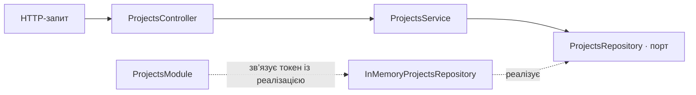

Вертикальний зріз проєктів на NestJS і TypeScript. Він реалізує створення, читання, часткове оновлення та видалення проєктів. Дані зберігаються в пам’яті процесу й скидаються після перезапуску. Учасники, завдання, коментарі та авторизація виходять за межі цього зрізу.

## Запуск

Потрібен Node.js 20 або новіший.

```sh
npm ci
npm test
npm start
```

`npm test` збирає проєкт і запускає HTTP-тести. Для запуску без тестів можна виконати `npm run build` перед `npm start`. Типова адреса — `http://localhost:3000/api/projects`; порт задає змінна `PORT`.

## Маршрути

| Метод | Адреса | Тіло запиту | Успішна відповідь |
| --- | --- | --- | --- |
| POST | `/api/projects` | `name`, необов’язкове `description` | 201, створений проєкт |
| GET | `/api/projects` | — | 200, масив проєктів за зростанням ID |
| GET | `/api/projects/:projectId` | — | 200, проєкт |
| PATCH | `/api/projects/:projectId` | `name` та/або `description` | 200, оновлений проєкт |
| DELETE | `/api/projects/:projectId` | — | 204, без тіла |

`name` має містити від 3 до 100 символів після обрізання пробілів. `description` — рядок, за замовчуванням порожній. Сервер призначає `id` і `createdAt`. PATCH залишає пропущені поля без змін. Некоректне тіло або ID дають 400; відсутній проєкт — 404. Після видалення повторний DELETE повертає 404.

```sh
curl -i http://localhost:3000/api/projects \
  -H 'Content-Type: application/json' \
  -d '{"name":"Підготовка до іспиту"}'
```

## Залежності



Контролер оголошує маршрути, приймає HTTP-параметри й делегує виклики. Сервіс перевіряє дані та вирішує, що робити, коли проєкту немає. Порт визначає п’ять операцій, доступних сервісу. Адаптер зберігає записи й генерує ID та час створення. Модуль реєструє адаптер за токеном `PROJECTS_REPOSITORY`, щоб сервіс можна було підключити до іншого сховища без змін у сервісі та контролері.

## Контрольні запитання

1. **Навіщо DI, якщо клас можна створити через `new`?** DI відділяє створення залежності від її використання. Якби сервіс сам викликав `new InMemoryProjectsRepository()`, він був би прив’язаний до конкретного сховища. З DI реалізацію вибирає модуль, а в тесті можна підставити іншу.
2. **Чого не повинно бути у контролері?** Запитів до бази, роботи зі сховищем і бізнес-правил. Контролер працює з HTTP: читає параметри, викликає сервіс і задає спосіб повернення відповіді.
3. **Коли виправданий інтерфейс репозиторію?** Коли бізнес-логіку варто відокремити від конкретного сховища, наприклад щоб замінити пам’ять на базу даних або тестувати сервіс зі спрощеним адаптером. Інтерфейс описує контракт для TypeScript, а [токен провайдера](https://docs.nestjs.com/fundamentals/custom-providers) дає NestJS змогу знайти реалізацію під час виконання.
# StudyFlow
