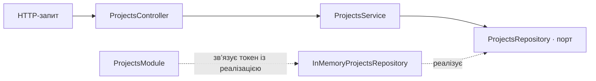

# StudyFlow Projects

Вертикальний зріз проєктів на NestJS і TypeScript. Він реалізує створення, читання, часткове оновлення та видалення проєктів. Дані зберігаються в пам’яті процесу й скидаються після перезапуску. Учасники, завдання, коментарі та авторизація виходять за межі цього зрізу.

## Запуск

Потрібен Node.js 20 або новіший.

```sh
npm ci
npm test
npm start
```

`npm test` збирає проєкт і запускає HTTP-тести. Для запуску без тестів можна виконати `npm run build` перед `npm start`. Типова адреса — `http://localhost:3000/projects`; порт задає змінна `PORT`. У практичній роботі 4 префікс `/api` прибрано відповідно до адрес у завданні; всі п’ять CRUD-операцій залишилися в наявному модулі Projects.

## Практична робота OpenAPI

- [Репозиторій практичної роботи на GitHub](https://github.com/truesentry/StudyFlow).
- Swagger UI: [localhost:3000/docs](http://localhost:3000/docs). Після запуску застосунку можна розгорнути операцію в групі **Projects** і натиснути **Try it out**.
- OpenAPI JSON: [localhost:3000/openapi.json](http://localhost:3000/openapi.json) або [файл openapi.json](./openapi.json) у репозиторії.

Документ описує всі п’ять операцій Projects: параметр id, схеми запитів і відповідей, коди статусів, єдину схему помилок і приклади JSON. Bearer-схему оголошено, але до операцій її не застосовано: API не перевіряє токени й не вимагає авторизації.

Щоб оновити документ після змін у контролері або DTO, запусти:

```sh
npm run openapi:generate
npm run openapi:lint
```

Для Redocly CLI потрібен Node.js 20.19+ (гілка 20) або 22.12+. Лінтер перевіряє рекомендовані правила й відповідність прикладів схемам. У `.redocly.lint-ignore.yaml` є три точкові винятки: репозиторій не декларує ліцензії, список проєктів не має штатної помилки 4xx, а Bearer-схема зарезервована. HTTP-тест перевіряє, що Swagger UI доступний, а згенерований файл збігається зі схемою, яку віддає сервер.

## Маршрути

| Метод | Адреса | Тіло запиту | Успішна відповідь |
| --- | --- | --- | --- |
| POST | `/projects` | `name`, `status`, необов’язкове `description` | 201, створений проєкт |
| GET | `/projects` | — | 200, масив проєктів за зростанням ID |
| GET | `/projects/:id` | — | 200, проєкт |
| PATCH | `/projects/:id` | `name`, `description` та/або `status` | 200, оновлений проєкт |
| DELETE | `/projects/:id` | — | 204, без тіла |

`name` має містити від 3 до 100 символів після обрізання пробілів. `description` — необов’язковий рядок до 500 символів після обрізання пробілів, за замовчуванням порожній. `status` у POST обов’язковий: `draft`, `active` або `completed`. Сервер призначає `id` і `createdAt`. PATCH залишає пропущені поля без змін, але порожній об’єкт повертає 400. Значення `null` заборонено для всіх трьох полів. Після видалення повторний DELETE повертає 404.

```sh
curl -i http://localhost:3000/projects \
  -H 'Content-Type: application/json' \
  -d '{"name":"StudyFlow","description":"Система керування навчальними проєктами","status":"active"}'
```

## Залежності



Контролер оголошує маршрути, приймає DTO та числовий ID і делегує виклики. Глобальний ValidationPipe перевіряє DTO до виклику контролера. Сервіс перевіряє наявність проєкту й унікальність назви. Порт визначає CRUD і пошук за назвою. Адаптер зберігає записи й генерує ID та час створення. Модуль реєструє адаптер за токеном `PROJECTS_REPOSITORY`, щоб сервіс можна було підключити до іншого сховища без змін у сервісі та контролері.

## Валідація та серіалізація

`CreateProjectDto` і `UpdateProjectDto` використовують `class-validator` та `class-transformer`. У `main.ts` глобально підключено `ValidationPipe` із `whitelist: true`, `forbidNonWhitelisted: true`, `transform: true`. Невідомі поля повертають 400; поля рядкового типу не перетворюються з чисел. Усі поля UpdateProjectDto необов’язкові; передані значення перевіряються за тими самими правилами, що й під час створення. `ParseIntPipe` та перевірка в сервісі забезпечують додатний безпечний цілий ID.

Глобальний `ClassSerializerInterceptor` разом із `@SerializeOptions({ type: ProjectResponseDto })` і декораторами `@Exclude` та `@Expose` повертає лише `id`, `name`, `description`, `status`, `createdAt`. Це правило працює для POST, GET одного запису, GET списку та PATCH. Навіть якщо адаптер додасть `internalNote`, `deletedAt` чи нове службове поле, вони не потраплять до клієнта. DELETE повертає 204 без тіла.

## Єдиний формат помилок

Глобальний `HttpExceptionFilter` охоплює помилки DTO, параметрів, сервісу, некоректного JSON, невідомих маршрутів і неочікувані збої. `message` завжди є рядком; повідомлення кількох порушень валідації об’єднуються через крапку з комою.

```json
{
  "statusCode": 404,
  "errorCode": "PROJECT_NOT_FOUND",
  "message": "Project with id 10 was not found",
  "path": "/projects/10",
  "timestamp": "2026-11-07T10:00:00.000Z",
  "traceId": "550e8400-e29b-41d4-a716-446655440000"
}
```

`timestamp` сервер формує під час помилки, `path` містить фактичну адресу запиту, а `traceId` — новий UUID, також доступний у заголовку `X-Trace-Id`. Для неочікуваних збоїв клієнт отримує нейтральне повідомлення; стек записується тільки в серверний журнал разом із traceId.

| Статус | errorCode | Причина |
| --- | --- | --- |
| 400 | `VALIDATION_ERROR` | Неправильні поля, зайві поля, порожній PATCH або некоректний JSON |
| 400 | `INVALID_PROJECT_ID` | Не ціле число, недодатний або небезпечний ID |
| 404 | `PROJECT_NOT_FOUND` | Проєкт не існує |
| 404 | `NOT_FOUND` | Маршрут не існує |
| 409 | `PROJECT_NAME_CONFLICT` | Назва вже зайнята іншим проєктом |
| 500 | `INTERNAL_SERVER_ERROR` | Неочікуваний внутрішній збій |

Унікальність назви перевіряється після обрізання пробілів, з урахуванням регістру. Перевірка виконується під час POST та PATCH; зберегти власну поточну назву дозволено. Адаптер додатково гарантує унікальність під час запису, щоб одночасні запити не створили дублікати. `DuplicateProjectNameError` сервіс перетворює на `ConflictException`. Під час переходу на базу даних потрібне відповідне UNIQUE-обмеження й таке саме перетворення помилки адаптера.

## Перевірка

`npm test` використовує ту саму глобальну конфігурацію, що й запуск застосунку. HTTP-тести охоплюють CRUD, перетворення DTO та ID, межі довжин, enum, зайві поля, null, атомарність PATCH, конфлікти назв і одночасні записи, приховування внутрішніх полів у всіх відповідях, формат помилок 400/404/409/500, некоректний JSON та traceId.

Документація NestJS: [валідація](https://docs.nestjs.com/techniques/validation), [серіалізація](https://docs.nestjs.com/techniques/serialization), [фільтри помилок](https://docs.nestjs.com/exception-filters).

# StudyFlow
