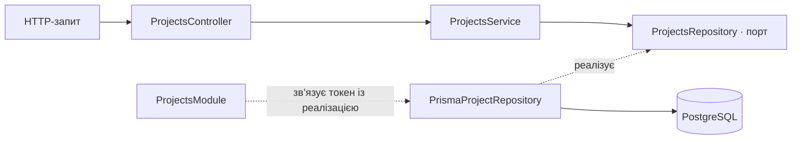

# StudyFlow Projects

Вертикальний зріз проєктів на NestJS і TypeScript. Він реалізує створення, читання, часткове оновлення та видалення проєктів. Проєкти зберігаються в PostgreSQL і залишаються доступними після перезапуску API. Користувачі, завдання й участь змодельовані в базі; до проєкту можна додавати учасників через HTTP.

## Запуск

Потрібні Node.js 20.19+, 22.12+ або 24+ і PostgreSQL. Для локальної бази можна використати Docker Compose:

```sh
npm ci
cp .env.example .env
docker compose up -d --wait
npm run db:migrate
npm run db:seed
npm run build
npm start
```

Якщо PostgreSQL уже запущений, пропусти Docker Compose і вкажи адресу своєї локальної бази в `DATABASE_URL` у файлі `.env`. Seed додає демонстраційні записи й не потрібен для звичайного запуску API. Типова адреса — `http://localhost:3000/api/projects`; порт задає змінна `PORT`. У практичній роботі 7 основні маршрути мають префікс `/api`; старі адреси `/projects` залишені як aliases.

## Практична робота 7

Список повертає `{ data, meta }`. У `meta` є `page`, `size`, `total`, `totalPages`, `hasNextPage`, `hasPreviousPage`. `total` враховує ті самі фільтри, що й `data`; дані й кількість читаються в транзакції з ізоляцією Repeatable Read.

| Параметр | Правило | Типове значення |
| --- | --- | --- |
| page | Ціле число від 1 до Number.MAX_SAFE_INTEGER | 1 |
| size | Ціле число від 1 до 100 | 10 |
| status | draft, active, completed | Без фільтра |
| assigneeId | Додатний INTEGER ID користувача | Без фільтра |
| sort | createdAt, updatedAt, name | createdAt |
| order | asc, desc | desc |

Відповідальний визначається через `Membership.role = owner`. Використано числовий `assigneeId`, бо модель User має числовий первинний ключ. Звичайна участь із роллю member не робить користувача відповідальним. За наявності status і assigneeId застосовуються обидва фільтри.

Приклади:

```text
GET /api/projects?page=1&size=5&status=active&sort=name&order=asc
GET /api/projects?assigneeId=1&sort=updatedAt&order=desc
```

Сортування завжди має другий ключ `id` у тому самому напрямку. Фільтрацію, сортування й пагінацію виконує PostgreSQL через Prisma. Поле updatedAt додано міграцією для сортування; формат одного проєкту у відповіді не змінено. Порожній результат і сторінка поза діапазоном дають 200 та data: []; totalPages дорівнює 0 для порожньої вибірки. hasPreviousPage означає page > 1, навіть якщо сторінка виходить за межі списку.

Для POST потрібен ownerId наявного користувача, оскільки автентифікацію ще не реалізовано. Project і Membership з роллю owner створюються в одній транзакції. Якщо власника немає, HTTP повертає 404 OWNER_NOT_FOUND, а створення Project відкочується. ownerId не є полем Project і не зберігається через PATCH.

POST /api/projects/:id/memberships додає member. Повторне додавання повертає 409 MEMBERSHIP_ALREADY_EXISTS у попередньому форматі помилки з errorCode, path, timestamp і traceId. Це також стосується спроби повторно додати власника.

`npm run test:postgres` перевіряє межі page/size, обидва фільтри, стабільне сортування, метадані, owner membership, rollback при помилці зовнішнього ключа та повторний membership. Rollback перевіряється окремим читанням таблиці Project після завершення невдалої транзакції.

## PostgreSQL і Prisma

Моделі `Project`, `User`, `Task` і `Membership` мають числові первинні ключі. Назва проєкту й email користувача унікальні. Зовнішні ключі пов’язують завдання з проєктом, а участь — із проєктом і користувачем. Унікальна пара `(projectId, userId)` запобігає дублюванню участі. Індекс `(projectId, status)` підтримує пошук завдань проєкту за статусом, а індекс `Membership.userId` — пошук проєктів користувача. Після видалення проєкту база видаляє його завдання й записи участі.

`npm run db:migrate` застосовує SQL-міграції, збережені в `prisma/migrations`. `npm run db:seed` додає демонстраційний проєкт, двох користувачів, їхні ролі й завдання. Послідовний повторний запуск не створює дублікатів. Команда налаштована через [Prisma 7 seeding](https://www.prisma.io/docs/orm/v7/prisma-migrate/workflows/seeding).

Для перевірки збереження даних на окремій локальній тестовій базі після міграції запусти `npm run test:postgres`. Тест створює запис через HTTP, перезапускає процес API, читає й оновлює запис, ще раз перезапускає API та перевіряє оновлення. Після видалення наступний запуск повертає 404 для цього ID. Тест не вимагає порожньої бази й використовує унікальну назву для свого запису.

## Практична робота OpenAPI

- [Репозиторій практичної роботи на GitHub](https://github.com/truesentry/StudyFlow).
- Swagger UI: [localhost:3000/docs](http://localhost:3000/docs). Після запуску застосунку можна розгорнути операцію в групі **Projects** і натиснути **Try it out**.
- OpenAPI JSON: [localhost:3000/openapi.json](http://localhost:3000/openapi.json) або [файл openapi.json](./openapi.json) у репозиторії.

Документ описує CRUD і додавання учасника до Projects: параметр id, схеми запитів і відповідей, коди статусів, єдину схему помилок і приклади JSON. Bearer-схему оголошено, але до операцій її не застосовано: API не перевіряє токени й не вимагає авторизації.

Щоб оновити документ після змін у контролері або DTO, запусти:

```sh
npm run openapi:generate
npm run openapi:lint
```

Для Redocly CLI потрібен Node.js 20.19+ (гілка 20) або 22.12+. Лінтер перевіряє рекомендовані правила й відповідність прикладів схемам. У `.redocly.lint-ignore.yaml` є два точкові винятки: репозиторій не декларує ліцензії, а Bearer-схема зарезервована. HTTP-тест перевіряє, що Swagger UI доступний, а згенерований файл збігається зі схемою, яку віддає сервер.

## Маршрути

| Метод | Адреса | Тіло запиту | Успішна відповідь |
| --- | --- | --- | --- |
| POST | `/api/projects` | `name`, `status`, `ownerId`, необов’язкове `description` | 201, створений проєкт |
| GET | `/api/projects` | query-параметри | 200, data і meta |
| GET | `/api/projects/:id` | — | 200, проєкт |
| PATCH | `/api/projects/:id` | `name`, `description` та/або `status` | 200, оновлений проєкт |
| DELETE | `/api/projects/:id` | — | 204, без тіла |
| POST | `/api/projects/:id/memberships` | `userId` | 201, створений membership |

`name` має містити від 3 до 100 символів після обрізання пробілів. `description` — необов’язковий рядок до 500 символів після обрізання пробілів, за замовчуванням порожній. `status` у POST обов’язковий: `draft`, `active` або `completed`. Сервер призначає `id` і `createdAt`. PATCH залишає пропущені поля без змін, але порожній об’єкт повертає 400. Значення `null` заборонено для всіх трьох полів. Після видалення повторний DELETE повертає 404.

```sh
curl -i http://localhost:3000/api/projects \
  -H 'Content-Type: application/json' \
  -d '{"name":"StudyFlow","description":"Система керування навчальними проєктами","status":"active","ownerId":1}'
```

## Залежності



Контролер оголошує маршрути, приймає DTO та числовий ID і делегує виклики. Глобальний ValidationPipe перевіряє DTO до виклику контролера. Сервіс перевіряє наявність проєкту й унікальність назви. Порт визначає CRUD і пошук за назвою. Адаптер записує дані через Prisma. PostgreSQL призначає ID і час створення; репозиторій повертає дату в тому самому форматі ISO 8601, що й попередній адаптер. Модуль реєструє адаптер за токеном `PROJECTS_REPOSITORY`, щоб сервіс можна було підключити до іншого сховища без змін у сервісі та контролері.

## Валідація та серіалізація

`CreateProjectDto` і `UpdateProjectDto` використовують `class-validator` та `class-transformer`. У `main.ts` глобально підключено `ValidationPipe` із `whitelist: true`, `forbidNonWhitelisted: true`, `transform: true`. Невідомі поля повертають 400; поля рядкового типу не перетворюються з чисел. Усі поля UpdateProjectDto необов’язкові; передані значення перевіряються за тими самими правилами, що й під час створення. `ParseIntPipe` та перевірка в сервісі забезпечують додатний безпечний цілий ID.

Глобальний `ClassSerializerInterceptor` разом із `@SerializeOptions({ type: ProjectResponseDto })` і декораторами `@Exclude` та `@Expose` повертає лише `id`, `name`, `description`, `status`, `createdAt`. Це правило працює для POST, GET одного запису, GET списку та PATCH. Навіть якщо адаптер додасть `internalNote`, `deletedAt` чи нове службове поле, вони не потраплять до клієнта. DELETE повертає 204 без тіла.

## Єдиний формат помилок

Глобальний `HttpExceptionFilter` охоплює помилки DTO, параметрів, сервісу, некоректного JSON, невідомих маршрутів і неочікувані збої. `message` завжди є рядком; повідомлення кількох порушень валідації об’єднуються через крапку з комою.

```json
{
  "statusCode": 404,
  "errorCode": "PROJECT_NOT_FOUND",
  "message": "Project with id 10 was not found",
  "path": "/projects/10",
  "timestamp": "2026-11-07T10:00:00.000Z",
  "traceId": "550e8400-e29b-41d4-a716-446655440000"
}
```

`timestamp` сервер формує під час помилки, `path` містить фактичну адресу запиту, а `traceId` — новий UUID, також доступний у заголовку `X-Trace-Id`. Для неочікуваних збоїв клієнт отримує нейтральне повідомлення; стек записується тільки в серверний журнал разом із traceId.

| Статус | errorCode | Причина |
| --- | --- | --- |
| 400 | `VALIDATION_ERROR` | Неправильні поля, зайві поля, порожній PATCH або некоректний JSON |
| 400 | `INVALID_PROJECT_ID` | Не ціле число, недодатний або небезпечний ID |
| 404 | `PROJECT_NOT_FOUND` | Проєкт не існує |
| 404 | `NOT_FOUND` | Маршрут не існує |
| 409 | `PROJECT_NAME_CONFLICT` | Назва вже зайнята іншим проєктом |
| 500 | `INTERNAL_SERVER_ERROR` | Неочікуваний внутрішній збій |

Унікальність назви перевіряється після обрізання пробілів, з урахуванням регістру. Перевірка виконується під час POST та PATCH; зберегти власну поточну назву дозволено. PostgreSQL гарантує унікальність назви під час запису, навіть якщо запити надходять одночасно. Репозиторій перетворює помилку Prisma `P2002` на `DuplicateProjectNameError`, а сервіс повертає клієнту той самий `409 PROJECT_NAME_CONFLICT`.

## Перевірка

`npm test` використовує ту саму глобальну HTTP-конфігурацію, що й запуск застосунку, з адаптером у пам’яті замість бази. HTTP-тести охоплюють CRUD, перетворення DTO та ID, межі довжин, enum, зайві поля, null, атомарність PATCH, конфлікти назв і одночасні записи, приховування внутрішніх полів у всіх відповідях, формат помилок 400/404/409/500, некоректний JSON та traceId.

Документація NestJS: [валідація](https://docs.nestjs.com/techniques/validation), [серіалізація](https://docs.nestjs.com/techniques/serialization), [фільтри помилок](https://docs.nestjs.com/exception-filters).

# StudyFlow
